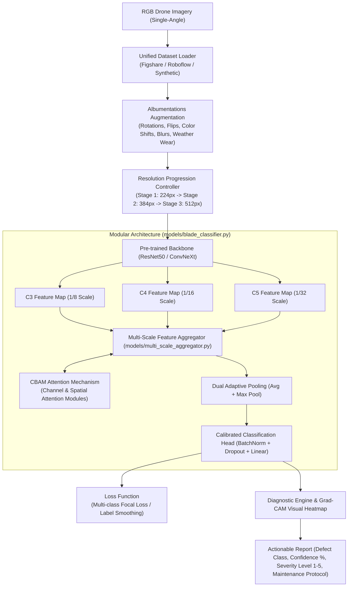

# Wind Turbine Blade Defect Classification MVP
**Two-Day Rapid Deployment Pipeline for Drone RGB Imagery Inspection**

[](https://pytorch.org/)
[](https://albumentations.ai/)
[]()
[]()
---

> **Read [`RESULTS_VERIFIED.md`](RESULTS_VERIFIED.md) first.** It holds the final, recomputed numbers (6 defect classes, leak-free 747/159/159 group split, ablation A/B/C, severity head vs. lookup baselines, failure analysis) and overrides anything below that disagrees. [`DISCLOSURE.md`](DISCLOSURE.md) covers dataset origin, the proxy severity rule and AI assistance.
>
> **Data:** not included. Download the Figshare *"Multiclass Dataset for Intelligent Detection of Wind Turbine Blade Defects Using Drone Imagery"* and extract it to `data/figshare/WT blade defect dataset/`. The split used is in `data/splits/leak_free_split_manifest.json`.
>
> **Weights:** checkpoints (~100–300 MB) exceed GitHub's file limit and are not in the repo.


## 1. Executive Summary & Objective

This repository contains a modular Machine Learning pipeline engineered to classify single-angle RGB drone inspection imagery into primary wind turbine blade defect categories:
- **`cracking`**: Structural fractures and surface hairline cracks along the trailing/leading edges.
- **`erosion`**: Leading-edge erosion, gel coat pitting, and surface particulate wear.
- **`delamination`**: Composite laminate skin-core separation, blistering, and buckling.
- **`normal`**: Pristine composite blade baseline to prevent false positive triggers.

Designed for a strict **two-day turnaround timeframe**, the codebase provides complete end-to-end functionality: automated dataset parsing (Figshare & Roboflow), heavy Albumentations data augmentation, pre-trained backbone with **CBAM Attention** and **Multi-Scale Feature Pyramid Aggregation**, a **Resolution Progression Training Strategy (224 → 384 → 512)**, and an **Automated Diagnostic Engine with Grad-CAM visual heatmaps and Severity Scoring**.

---

## 2. System Architecture



---

## 3. Key Pipeline Components

### 3.1. Unified Data Loader (`datasets/unified_loader.py`)
- **Figshare UAV Dataset**: Ingests the *"Multiclass Dataset for Intelligent Detection of Wind Turbine Blade Defects Using Drone Imagery"* (over 1,000 UAV inspection frames).
- **Roboflow Detection Collections**: Directly parses Roboflow YOLO-format labels (`.txt`) and bounding boxes, providing automatic localized defect cropping with aerodynamic padding margins.
- **Procedural Synthetic Generator (`datasets/mock_generator.py`)**: Instant generator of high-resolution drone blade images with procedural defects (Perlin fractures, erosion pitting clusters, delamination blisters) for immediate 2-day pipeline validation.

### 3.2. Heavy Albumentations Augmentation (`datasets/augmentations.py`)
Systematically counteracts small drone dataset scarcity and field lighting variance:
- **Flight Orientation Invariance**: `A.RandomRotate90(p=0.5)`, `A.HorizontalFlip(p=0.5)`, `A.VerticalFlip(p=0.5)`, `A.Affine(rotate=(-45, 45), p=0.7)`.
- **Flight Vibration / Motion Blur**: `A.OneOf([A.GaussianBlur, A.MotionBlur, A.MedianBlur], p=0.4)`.
- **Lighting & Atmospheric Shifts**: `A.ColorJitter(p=0.6)`, `A.RandomBrightnessContrast(p=0.5)`, `A.HueSaturationValue(p=0.4)`.
- **Environmental Wear & Sensor Artifacts**: `A.GaussNoise(p=0.4)`, `A.CoarseDropout(num_holes_range=(1, 4), p=0.4)`, `A.RandomFog(p=0.4)`, `A.RandomSunFlare(p=0.3)`.

### 3.3. CBAM Attention & Multi-Scale Aggregation (`models/`)
- **Convolutional Block Attention Module (CBAM)**: Sequential Channel Attention (learns *what* defect signatures matter) and Spatial Attention (learns *where* the defect lies, suppressing irrelevant sky/cloud/ocean background).
- **Multi-Scale Feature Aggregator**: Simultaneously leverages shallow high-resolution features (C3) for hairline micro-cracks, intermediate features (C4) for leading-edge erosion patches, and deep semantic features (C5) for macro-delaminations.

### 3.4. Resolution Progression Training Strategy (`training/progressive_trainer.py`)
Gradually scales image resolution across training epochs to optimize training dynamics and fine-tune sub-pixel defect features:
1. **Stage 1 (224×224)**: Rapid backbone convergence on general blade contours, geometry, and macro anomalies.
2. **Stage 2 (384×384)**: Intermediate learning of erosion pitting roughness and laminate boundary interfaces.
3. **Stage 3 (512×512)**: Fine-tuning attention mechanisms and high-frequency convolutional weights on intricate hairline cracks and micro-details.

### 3.5. Leading Repository References
- **`yuuStella` Semi-Supervised PyTorch Implementation**: Inspired the consistency regularization module (`training/semi_supervised.py`) for leveraging unlabeled UAV flyby frames via dual weak/strong augmentation pseudo-labeling.
- **`memari-majid` YOLO Wind Turbine Models**: Guided the multi-scale feature pyramid aggregation and Roboflow detection crop integration.

---

## 4. Quickstart Guide

### 4.1. Installation
```bash
pip install -r requirements.txt
```

### 4.2. Verify Integration & Run Unit Tests
```bash
python -m unittest discover -s tests -p "test_*.py" -v
```

### 4.3. Prepare Datasets / Generate Synthetic Benchmark
```bash
# Generate 100 benchmark drone images (25 per class) with Roboflow YOLO annotations
python scripts/prepare_datasets.py --generate-synthetic --samples-per-class 25
```

### 4.4. Execute Resolution Progression Training
```bash
# Run progressive training across 224 -> 384 -> 512 resolutions
python scripts/train.py --config config.yaml
```

### 4.5. Evaluate Model Metrics
```bash
python scripts/evaluate.py --checkpoint outputs/checkpoints/best_model_progressive.pth
```

### 4.6. Interactive Launcher & On-the-Fly Custom Image Inspection
Launch the interactive switch-and-case menu to test any image (from `0` to `1064`) on the fly:
```bash
python launch.py
# or
python launcher.py
```
Select option `[C]` (or enter any number between 0 and 1064) to diagnose the image and immediately open the side-by-side comparison image displaying the raw input image (with ground truth bounding box) next to the Grad-CAM thermal overlay.

### 4.7. Direct CLI Diagnostic Inspection
```bash
# Diagnose any Figshare drone frame by index number (0-1064) and auto-open comparison:
python scripts/diagnose.py --image-id 104 --show

# Diagnose a custom file path:
python scripts/diagnose.py --image "data/figshare/WT blade defect dataset/JPEGImages/0.jpg" --show
```

---

## 5. Sample Actionable Diagnostic Output & Side-by-Side Comparison

```
======================================================================
  WIND TURBINE BLADE INSPECTION REPORT: 104.jpg
======================================================================
• Ground Truth Defect:  CRACKING (Raw: crack)
• Model Prediction:     CRACKING (80.05%)
• Detection Verdict:    MATCH [CORRECT AI DETECTION]
• Defect Severity:      LEVEL 4 (HIGH)
• Anomaly Description:  Structural Substrate Fracture
• Failure Mechanism:    Stress concentration along trailing/leading edge; 
                        high probability of crack propagation into primary spar 
                        under cyclical aerodynamic gusts.
• Immediate Protocol:   Schedule rope-access non-destructive ultrasonic 
                        testing (NDT) within 48 to 72 hours. Curtail turbine 
                        operational pitch angle if wind gusts exceed 12 m/s.
• Side-by-Side Image:   outputs/diagnostics/inspection_compare_104.jpg
• Grad-CAM Overlay:     outputs/diagnostics/diagnosis_cam_104.jpg
======================================================================
```
